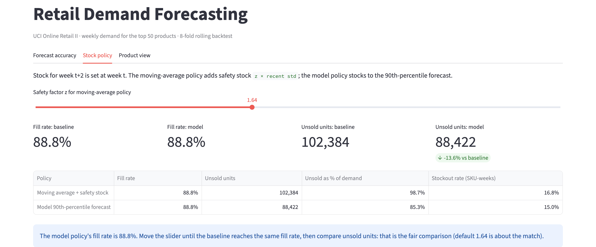
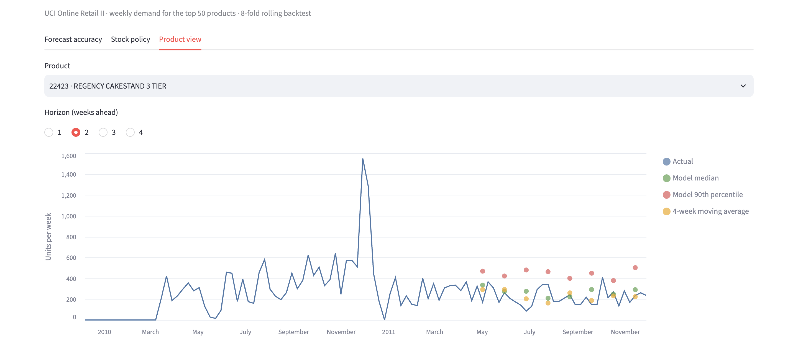

# Retail Demand Forecasting: 14% less excess stock at the same fill rate

**Live demo:** https://retail-demandforecasting.streamlit.app/





Forecast weekly product demand 1–4 weeks ahead for a wholesaler, then turn the forecasts into stock levels. On a backtest, the model-based policy carries **~14% less excess stock than a moving-average policy at the same fill rate**.

## Problem
A wholesaler must order stock ahead of demand (here, a 2-week lead time). Order too little and sales are lost; too much and cash is tied up in unsold stock. Standard practice is a moving average plus safety stock.

## Data
[UCI Online Retail II](https://archive.ics.uci.edu/dataset/502/online+retail+ii): ~1M transactions from a UK online wholesaler, Dec 2009 – Dec 2011. I removed cancellations, returns and non-product codes, then aggregated to weekly units for the top 50 products by revenue (104 weeks).

## Method
- **Features:** lags (1–4, 8, 52 weeks), rolling mean/std, orders and customers per week, market-wide momentum, share of zero-demand weeks, price change, week of year.
- **Model:** one pooled gradient-boosting model (scikit-learn `HistGradientBoostingRegressor`) per horizon. It predicts demand relative to each product's recent level, so a single model serves all products. Quantile loss gives a median forecast (0.5) and a high forecast (0.9) for stocking.
- **Evaluation:** rolling-origin backtest, 8 origins × 4 horizons. Training rows only use targets observed before each origin; a unit test checks that features never use future data.

## Results
| Model | WAPE (lower is better) |
|---|---|
| Gradient boosting (median) | **0.537** |
| 4-week moving average | 0.595 |
| Same week last year | 0.856 |

**Stock policy** (lead time 2 weeks; baseline's safety factor tuned to match the model's fill rate):

| Policy | Fill rate | Unsold units | Stockout rate (SKU-weeks) |
|---|---|---|---|
| Moving average + safety stock | 88.8% | 102,267 | 16.8% |
| Model 90th-percentile forecast | 88.8% | 88,422 | 15.0% |

(The dashboard slider rounds the baseline's safety factor to 1.64, which shows 102,384 unsold units; the exact match is 1.638.)

## Limitations
- One dataset, two years of history, 50 products; the 52-week seasonal lag is available for only part of the backtest.
- The stock result is a simulation with a single order-up-to level per week. It ignores order costs, minimum order quantities, holding costs and stock carried between weeks.
- The median forecast under-predicts total demand (bias −11%), as expected for a median on skewed data; stock levels use the 90th percentile instead.
- The explain assistant (Claude) only restates computed numbers and has not been evaluated for answer quality.

## Run it
```
pip install -r requirements-dev.txt
# download online_retail_ii.zip from the UCI link above and unzip into data/extracted/
python scripts/run_all.py     # rebuild panel + backtest, print results
pytest                        # unit tests
streamlit run app.py          # set ANTHROPIC_API_KEY to enable the explain assistant
```

```
src/data.py       cleaning + weekly panel
src/forecast.py   features, models, rolling-origin backtest
src/inventory.py  stock policies and comparison
src/explain.py    grounded Claude explanations
app.py            Streamlit dashboard
walkthrough.ipynb  walkthrough
```

## Deploy (Streamlit Community Cloud)
The dashboard only needs the two small files in `data/processed/` (committed), not the raw dataset.
1. Push this repo to GitHub.
2. At [share.streamlit.io](https://share.streamlit.io) create an app: pick the repo, branch `main`, main file `app.py`.
3. Optional: under **Advanced settings → Secrets** add `ANTHROPIC_API_KEY = "..."` to enable Claude explanations (limited to 5 per visitor session).
